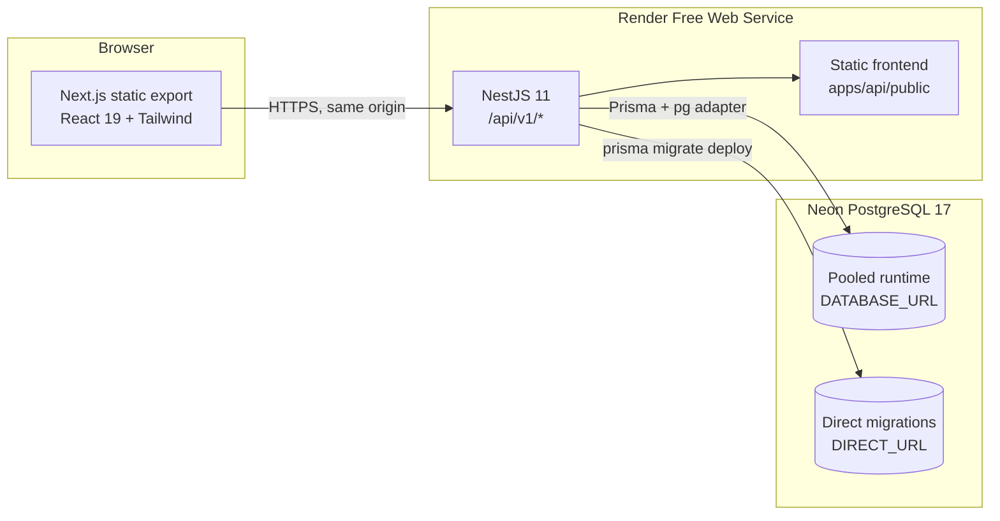
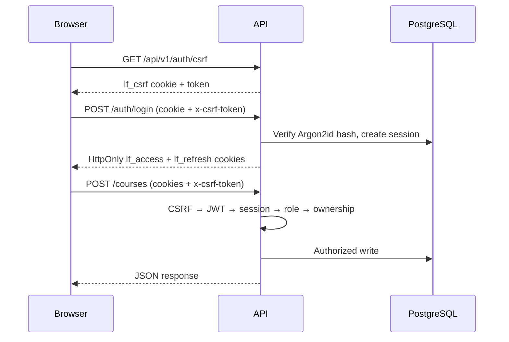
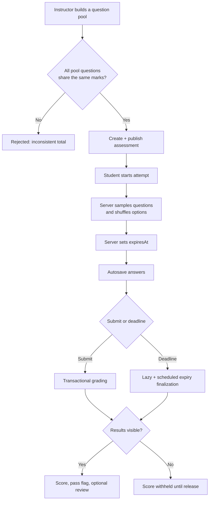
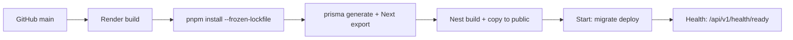

# LearnFlow

LearnFlow is a full-stack learning and assessment platform for instructors and students. It combines a structured course experience with a server-authoritative timed exam engine, role-based workspaces, and release-safe result reporting.

- **Frontend:** Next.js 15 (App Router, static export), React 19, TypeScript, Tailwind CSS
- **Backend:** NestJS 11, REST, Swagger/OpenAPI, JWT in HttpOnly cookies, Argon2id
- **Data:** PostgreSQL 17 (Neon), Prisma 7 with typed migrations
- **Deployment:** One Render Free web service serving both `/api/v1/*` and the static frontend from the same origin

No mock APIs, seeded fake metrics, or client-side grading are used. Every score, deadline, role check, and ownership check is enforced by the API.

---

## Architecture



### Request and security model



- Access and refresh tokens live in `HttpOnly`, `SameSite` cookies; refresh tokens rotate on every use and replay revokes the session.
- Unsafe cookie-authenticated requests require a double-submit `x-csrf-token` header that matches the `lf_csrf` cookie, plus an allowed `Origin`.
- Passwords use Argon2id. Password hashes, answer keys, and refresh hashes never leave the server.
- Global rate limiting, role guards, ownership checks, and an exception filter that hides internal errors are applied by default.
- Students never receive `isCorrect` flags or assessment pools. Results stay hidden until `showResultsImmediately` is on or the instructor explicitly releases them.

---

## Assessment engine



- The browser timer is derived from the server's `remainingSeconds`; changing the local clock cannot extend an attempt.
- Autosave is rejected after the server deadline.
- Grading runs in a transaction with row locks, writes one `AssessmentResult`, and is idempotent on repeated submit.
- Expired attempts are finalized lazily on read and by a scheduled job.
- Pool selection is only allowed when every question has the same mark value, so a randomized subset always has a predictable total.

---

## Repository layout

```text
apps/
  api/                 NestJS API, Prisma client output, tests
  web/                 Next.js static frontend
prisma/
  schema.prisma        Database schema
  migrations/          Production-safe SQL migrations
  seed.ts              Idempotent operator-account seed
scripts/
  copy-web.mjs         Copies the static export into apps/api/public
  migrate.mjs          Runs `prisma migrate deploy`
  render-start.mjs     Validates env, migrates, then starts the API
render.yaml            Single-service Render Blueprint
```

---

## Local setup

Requirements: Node.js 22+, pnpm 10+, PostgreSQL 15+ (Neon recommended).

```bash
corepack enable
pnpm install
cp .env.example .env
```

Fill in `.env`:

| Variable | Purpose |
| --- | --- |
| `DATABASE_URL` | Pooled runtime PostgreSQL URL |
| `DIRECT_URL` | Direct PostgreSQL URL for migrations |
| `TEST_DATABASE_URL` / `TEST_DIRECT_URL` | Isolated test branch for e2e tests |
| `JWT_SECRET` / `JWT_REFRESH_SECRET` | Different secrets, at least 32 characters |
| `FRONTEND_ORIGIN` | Browser origin allowed by CORS/CSRF (`http://localhost:3000` locally) |
| `COOKIE_SECURE` | `false` only for local HTTP |
| `INSTRUCTOR_BOOTSTRAP_SECRET` | Optional secret for creating the first instructor |
| `SEED_*` | Optional operator accounts for `pnpm prisma:seed` |

Apply migrations and start both apps:

```bash
pnpm prisma:generate
pnpm prisma:migrate:deploy
pnpm dev:api     # http://localhost:4000
pnpm dev:web     # http://localhost:3000
```

The dev frontend reads `NEXT_PUBLIC_API_BASE_URL` from `apps/web/.env.local`. In production this must be unset so the client calls the same-origin `/api/v1`.

### First accounts

Create an instructor with the bootstrap endpoint:

```bash
curl -X POST http://localhost:4000/api/v1/auth/bootstrap-instructor \
  -H "Content-Type: application/json" \
  -H "x-bootstrap-secret: $INSTRUCTOR_BOOTSTRAP_SECRET" \
  -d '{"name":"Ada Lovelace","email":"ada@example.com","password":"a-long-password"}'
```

Students can register normally. Remove `INSTRUCTOR_BOOTSTRAP_SECRET` after provisioning the first instructor.

For a repeatable, non-demo account seed:

```bash
SEED_PASSWORD='a-long-password' \
SEED_ADMIN_EMAIL='admin@example.com' \
SEED_INSTRUCTOR_EMAIL='instructor@example.com' \
SEED_STUDENT_EMAIL='student@example.com' \
pnpm prisma:seed
```

The seed is idempotent and never creates fake courses or metrics.

---

## Testing

```bash
pnpm typecheck     # API + web TypeScript
pnpm lint          # API + web ESLint
pnpm test          # Jest unit tests: guards, config, crypto
pnpm test:e2e      # Integration suite against TEST_DATABASE_URL
pnpm build         # static frontend + API + copy into apps/api/public
```

The e2e suite runs real HTTP requests through NestJS against the isolated Neon test branch and verifies:

- health/readiness and CSRF rejection
- instructor bootstrap, student registration, and role/ownership guards
- course, module, lesson, question, enrollment, and assessment creation
- timed attempt start, answer-key protection, autosave, and invalid-option rejection
- transactional grading and idempotent submission
- withheld results, instructor release, and student history serialization
- lazy expiry finalization and rejection of answers after the deadline
- logout and revoked-session rejection

Apply test migrations before running e2e:

```bash
DATABASE_URL="$TEST_DATABASE_URL" DIRECT_URL="$TEST_DIRECT_URL" pnpm prisma:migrate:deploy
```

---

## API overview

Swagger UI: `/api/docs`

| Area | Endpoints |
| --- | --- |
| Auth | `GET /auth/csrf`, `POST /auth/register`, `POST /auth/login`, `POST /auth/bootstrap-instructor`, `POST /auth/refresh`, `POST /auth/logout`, `GET/PATCH /auth/me`, `POST /auth/change-password` |
| Courses | `GET/POST /courses`, `GET/PATCH/DELETE /courses/:id`, publish/archive, modules, lessons, lesson completion |
| Enrollments | `POST/DELETE /courses/:id/enroll`, `GET /enrollments/me`, `GET /courses/:id/enrollments` |
| Question bank | `GET/POST /questions`, `GET/PATCH/DELETE /questions/:id`, `GET /questions/topics` |
| Assessments | CRUD, publish/unpublish, `POST /assessments/:id/release-results`, preview, report, attempts, CSV |
| Attempts | `POST /assessments/:id/attempts`, `GET /attempts/:id`, `PUT /attempts/:id/answers/:questionId`, `POST /attempts/:id/submit`, `GET /attempts/:id/result`, `GET /attempts/me/history` |
| Analytics | Student dashboard, instructor dashboard, course analytics |
| Admin | User list, role/status management, platform metrics |
| Health | `GET /health/live`, `GET /health/ready` |

All API routes are prefixed with `/api/v1`.

---

## Deployment on Render

`render.yaml` defines one Free web service. It builds the frontend, builds the API, copies the export into `apps/api/public`, and starts `scripts/render-start.mjs`, which runs `prisma migrate deploy` before booting.



Set these environment variables in Render:

- `DATABASE_URL` — Neon pooled URL
- `DIRECT_URL` — Neon direct URL (never used at runtime by the app pool)
- `FRONTEND_ORIGIN` — the final `https://<service>.onrender.com` URL
- `JWT_SECRET`, `JWT_REFRESH_SECRET`, `INSTRUCTOR_BOOTSTRAP_SECRET` — generated by the Blueprint
- `COOKIE_SECURE=true`, `COOKIE_SAME_SITE=lax`, `NODE_ENV=production`

After the first deploy, set `FRONTEND_ORIGIN` to the live HTTPS URL and create the first instructor. The same origin serves the UI and API, so `NEXT_PUBLIC_API_BASE_URL` must remain unset.

---

## Operational notes

- Migrations are applied with `prisma migrate deploy`; production never uses `db push`.
- The API refuses to start in production without PostgreSQL URLs, distinct 32+ character JWT secrets, and `FRONTEND_ORIGIN`.
- `GET /api/v1/health/live` is process liveness. `GET /api/v1/health/ready` also verifies the database.
- Logs are structured JSON access logs that exclude cookies, authorization headers, and request bodies.
- Render Free instances sleep when idle; the first request after sleep may take a few seconds while the service and database wake up.
